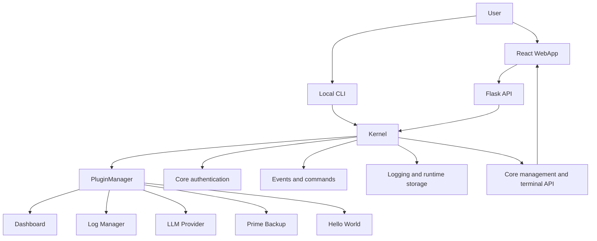

# Conductor Universal audit

Conductor is a general-purpose plugin kernel. The kernel owns events, commands,
users, permissions, logging, dependency coordination and core management APIs.
The retained plugins are Dashboard, Log Manager, LLM Provider, Prime Backup and
the Hello World example.

The former domain-specific experiment and external bridge are removed from this
universal distribution. Their source and reference material is kept only in the
local ignored `archive/` directory when available.

## Current request flow

1. `python -m conductor` creates a Kernel and discovers plugins.
2. PluginManager orders plugins by metadata dependencies and priority.
3. Core services register before plugin blueprints.
4. Flask exposes login, status, content intake, plugin APIs and `/api/core/*`.
5. The WebApp consumes the generated plugin route manifest and fixed Core pages.
6. The local CLI and Core Web Terminal execute the same Kernel command tree.

## Current boundaries

- `conductor/core`: generic runtime and security logic.
- `conductor/interface`: Flask application and console interface.
- `conductor/plugins/core`: retained first-party capabilities.
- `conductor/plugins`: regular/example plugins.
- `archive`: local-only references, templates and backups; never committed.

## Known limitations

- Runtime dependency installation still requires Poetry and Yarn to be installed.
- The frontend route manifest is generated when the backend starts.
- Feature implementations remain intentionally lightweight; this cleanup focuses
  on boundaries, authentication and clone-to-run setup.
